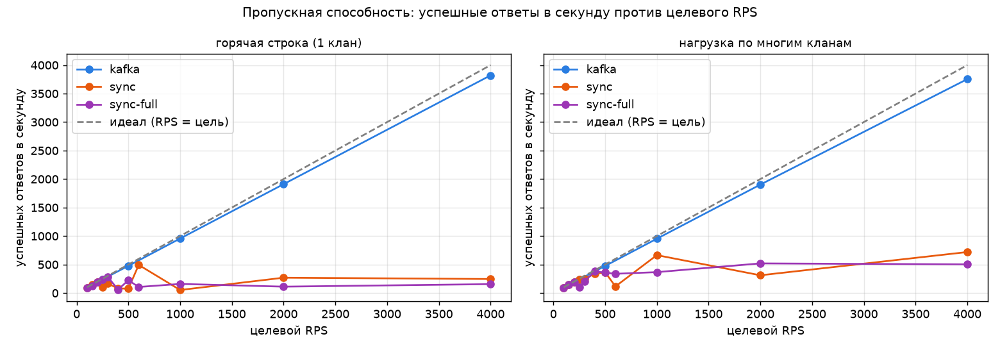
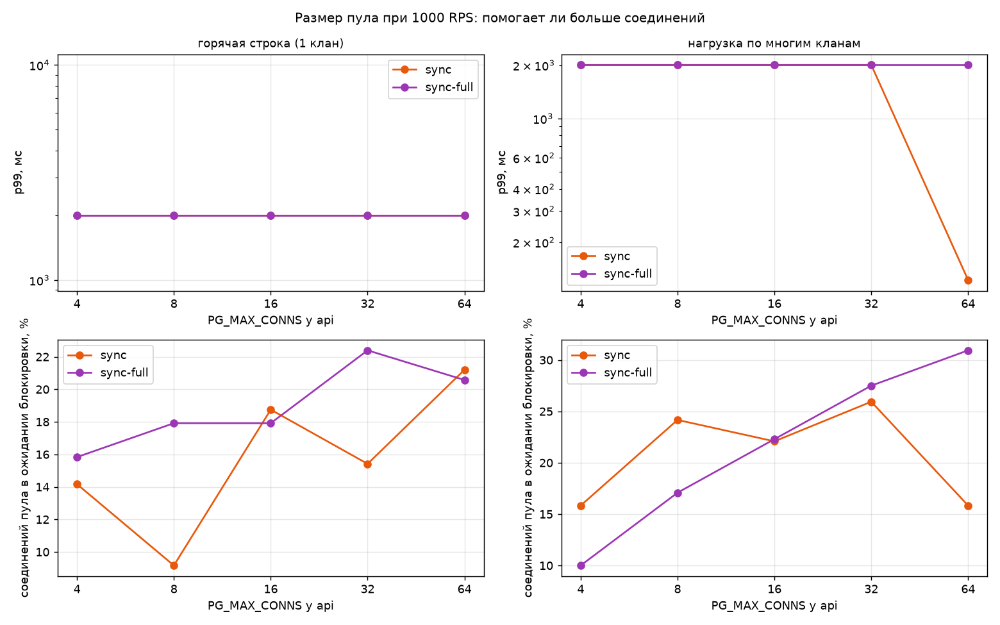

# raidboss — сервис клановых рейд-боссов на Go

Учебный проект: бэкенд игровой механики «клановый рейд-босс». Кланы атакуют общего босса, тысячи игроков одновременно бьют по одному запасу HP. Босс должен умереть ровно один раз, награды должны выдаться ровно один раз, лидерборд урона обновляется в реальном времени.

Что прокачивается: конкурентность в Go, gRPC и protobuf (unary и server streaming, interceptors, дедлайны), Kafka (партиционирование, consumer groups, at-least-once), Redis (Lua, sorted sets, pub/sub), PostgreSQL (транзакции, блокировки, outbox), observability и нагрузочное тестирование.


<!-- Раскомментировать после снимка дашборда Grafana под нагрузкой (docs/dashboard.png):

-->

---

## 1. Доменная модель и правила

**Сущности**

- **Clan** — клан.
- **Player** — игрок. Состоит в одном клане, у него есть `power` (100–1000).
- **Raid** — экземпляр босса для клана: `hp_max`, `hp_left`, статус `active | defeated | expired`, время начала и окончания.
- **Hit** — удар игрока по рейду.
- **Reward** — награда за рейд.

**Правила**

1. У клана не больше одного активного рейда одновременно. Это гарантирует БД, а не код.
2. Бить можно только босса своего клана и только пока рейд `active`.
3. Урон считает сервер, а не клиент: `damage = round(power × u × crit)`, где `u` — случайное число, равномерно распределённое в [0.8, 1.2), а `crit` = 2 с вероятностью 10%, иначе 1. Пример: при `power = 500` обычный удар — 400–600, крит — 800–1200. Средний урон с учётом критов — `power × 1.1`.
4. Лимит: 5 ударов в секунду на игрока, burst 10. Сверх лимита — `RESOURCE_EXHAUSTED`.
5. Удар, который опустил HP до 0 и ниже, — **killing blow**. Удары после него в зачёт не идут (считаются «опоздавшими»).
6. Рейд, не убитый до `ends_at`, переходит в `expired`. Награды за него не выдаются.
7. Награды за убитого босса:
   - `participation` — каждому, кто нанёс урон: `100 + floor(1000 × доля_урона_игрока)`;
   - `top3` — +500 / +300 / +200 за 1–3 места по урону;
   - `killing_blow` — +250 автору добивающего удара.
8. Повтор запроса с тем же `idempotency_key` не создаёт второй удар.

---

## 2. Архитектура

```
 botsim ──gRPC──► api ──produce──► Kafka: raid.hits (key = raid_id)
                   │                          │
                   │ rate limit, кэш          ▼
                   ▼                  hits-consumer ──tx──► PostgreSQL
                 Redis ◄──────────────────────┘ ZADD/SET/PUBLISH      │
                   │                                                  │ outbox
                   │ pub/sub                                          ▼
                   ▼                                            outbox-relay
   api (WatchRaid, gRPC stream) ──► клиенты                           │
                                                                      ▼
                                        Kafka: raid.events, rewards.granted
                                                      │
                                                      ▼
                                               rewards-worker ──tx──► PostgreSQL
```

**Источник правды — PostgreSQL.** Redis — кэш, лидерборд и pub/sub. Он должен восстанавливаться из Postgres полностью.

**Ключевая идея.** Все удары одного рейда попадают в одну партицию Kafka (ключ `raid_id`) и обрабатываются одним консьюмером по порядку. Конкуренция за «горячую» строку босса снимается партиционированием, а не блокировками. Этап 9 проверяет это замером.

**Один контракт.** Внешний API и сообщения Kafka описаны в protobuf в каталоге `proto/`. Совместимость схем проверяется в CI через `buf breaking`.

### Телеметрия

```
 все сервисы ──OTLP/gRPC──► otel-collector ──► Tempo           (трейсы)
 (OTel SDK)                               ├──► VictoriaMetrics (метрики, remote write)
                                          └──► Loki            (логи, по желанию)
```

Сервисы знают только один адрес — `OTEL_EXPORTER_OTLP_ENDPOINT=http://otel-collector:4317`. Батчинг, повторы, сэмплирование и выбор бэкендов настраиваются в коллекторе, а не в каждом сервисе. В compose коллектор один (gateway); в Kubernetes его обычно ставят агентом на узел или sidecar'ом рядом с сервисом.

Базовый конфиг (этап 0, без сэмплирования):

```yml
# deploy/otel-collector.yml
receivers:
  otlp:
    protocols:
      grpc:
        endpoint: 0.0.0.0:4317

processors:
  memory_limiter:
    check_interval: 1s
    limit_mib: 512
  batch: {}

exporters:
  otlp/tempo:
    endpoint: tempo:4317
    tls: { insecure: true }
  prometheusremotewrite:
    endpoint: http://victoriametrics:8428/api/v1/write

extensions:
  health_check: {}

service:
  extensions: [health_check]
  pipelines:
    traces:
      receivers: [otlp]
      processors: [memory_limiter, batch]
      exporters: [otlp/tempo]
    metrics:
      receivers: [otlp]
      processors: [memory_limiter, batch]
      exporters: [prometheusremotewrite]
```

На этапе 7 в конвейер трейсов добавляется tail sampling, а по желанию — конвейер логов в Loki.

### Бинарники (`cmd/`)

| Сервис | Что делает |
|---|---|
| `api` | gRPC API: приём ударов, стрим `WatchRaid`, чтение лидерборда |
| `hits-consumer` | Читает `raid.hits`, применяет урон в Postgres, обновляет Redis |
| `rewards-worker` | Читает `raid.events`, начисляет награды |
| `outbox-relay` | Переносит события из таблицы `outbox` в Kafka |
| `scheduler` | Переводит просроченные рейды в `expired` |
| `botsim` | Нагрузочный симулятор игроков (gRPC-клиент) |
| `raidctl` | CLI: seed, verify (проверка инвариантов), rebuild-cache, outbox dump, topics diff/apply |
| `raidwatch` | Терминальный демо-клиент: живое состояние рейда через `WatchRaid` |

### Структура репозитория

```
proto/
  raidboss/v1/          raid.proto — внешний API
  raidboss/events/v1/   events.proto — сообщения Kafka
gen/                    сгенерированный Go-код (коммитится в репозиторий)
buf.yml, buf.gen.yml
cmd/                    api, hits-consumer, rewards-worker, outbox-relay, scheduler, botsim, raidctl, raidwatch
internal/
  config/       конфиг из env
  domain/       сущности, расчёт урона и наград (чистые функции, без I/O)
  grpcapi/      реализация RaidService, маппинг ошибок в коды gRPC
  interceptors/ auth (player id), rate limit
  raid/         бизнес-логика обработки ударов
  storage/pg/   репозитории на pgx
  storage/rdb/  Redis: лидерборд, кэш HP, rate limit (Lua)
  kafka/        продюсер, консьюмер, проброс trace-контекста
  outbox/       relay
  watch/        hub для стрима WatchRaid
  telemetry/    OTel, метрики
migrations/     SQL-миграции (goose)
deploy/         docker-compose.yml (инфраструктура), docker-compose.dev.yml (dev-инструменты),
                otel-collector.yml, конфиги Grafana, (опц.) k8s
loadtest/       сценарии и результаты
docs/           GIF демо-клиента, скриншоты дашборда, сценарии vhs
```

### Стек

- Go — актуальная стабильная версия, логирование через `log/slog`.
- gRPC: `google.golang.org/grpc`, `google.golang.org/protobuf`. Кодогенерация через `buf` (`protoc-gen-go`, `protoc-gen-go-grpc`).
- Middleware: `grpc-ecosystem/go-grpc-middleware/v2` (recovery, logging), стандартный `grpc.health.v1`, server reflection.
- Отладка: `grpcurl` и `grpcui` (веб-интерфейс к gRPC, только в dev). Быстрые бенчмарки отдельных RPC: `ghz`.
- Демо-клиент: `charmbracelet/bubbletea` и `lipgloss`, запись GIF — `charmbracelet/vhs`.
- PostgreSQL: `jackc/pgx/v5` — в сервисах только через пул `pgx/v5/pgxpool` (см. 6.7), миграции `pressly/goose`.
- Kafka: `twmb/franz-go`, в compose — Kafka в режиме KRaft (или Redpanda).
- Redis: `redis/go-redis/v9`.
- `golang.org/x/sync` (`errgroup`, `singleflight`), `google/uuid` (UUIDv7).
- OpenTelemetry Go SDK и `otelgrpc` (подключается через `grpc.StatsHandler`). Все сервисы отправляют телеметрию по OTLP в **OpenTelemetry Collector** (образ `otel/opentelemetry-collector-contrib`), а он — дальше: трейсы в Grafana Tempo, метрики в VictoriaMetrics, логи (по желанию) в Loki. Дашборды — в Grafana.
- Тесты: стандартный `testing`, `bufconn` для in-memory gRPC, `testcontainers-go`, `go test -race`. Линтеры: `golangci-lint`, `buf lint`.
- Нагрузка: собственный `botsim` с гистограммами `HdrHistogram/hdrhistogram-go`.

---

## 3. gRPC API

### Контракт

```protobuf
// proto/raidboss/v1/raid.proto
syntax = "proto3";

package raidboss.v1;

option go_package = "github.com/<you>/raidboss/gen/raidboss/v1;raidbossv1";

import "google/protobuf/timestamp.proto";

service RaidService {
  rpc CreateRaid(CreateRaidRequest) returns (CreateRaidResponse);
  rpc GetRaid(GetRaidRequest) returns (GetRaidResponse);
  rpc Attack(AttackRequest) returns (AttackResponse);
  rpc GetLeaderboard(GetLeaderboardRequest) returns (GetLeaderboardResponse);
  rpc WatchRaid(WatchRaidRequest) returns (stream WatchRaidResponse);
  rpc ListRewards(ListRewardsRequest) returns (ListRewardsResponse);
}

enum RaidStatus {
  RAID_STATUS_UNSPECIFIED = 0;
  RAID_STATUS_ACTIVE = 1;
  RAID_STATUS_DEFEATED = 2;
  RAID_STATUS_EXPIRED = 3;
}

message Raid {
  string id = 1;
  int64 clan_id = 2;
  string boss_name = 3;
  int64 hp_max = 4;
  int64 hp_left = 5;
  RaidStatus status = 6;
  google.protobuf.Timestamp ends_at = 7;
}

message CreateRaidRequest {
  int64 clan_id = 1;
  string boss_name = 2;
  int64 hp_max = 3;
  int32 duration_sec = 4;
}
message CreateRaidResponse { Raid raid = 1; }

message GetRaidRequest { string raid_id = 1; }
message GetRaidResponse { Raid raid = 1; }

// Игрок берётся из metadata "x-player-id".
message AttackRequest {
  string raid_id = 1;
  string idempotency_key = 2; // UUID, генерирует клиент; повтор с тем же ключом — тот же удар
}
message AttackResponse {
  string hit_id = 1;
  int32 damage = 2;
  bool is_crit = 3;
}

message GetLeaderboardRequest {
  string raid_id = 1;
  int32 limit = 2;
}
message LeaderboardEntry {
  int64 player_id = 1;
  int64 total_damage = 2;
}
message GetLeaderboardResponse { repeated LeaderboardEntry entries = 1; }

message WatchRaidRequest { string raid_id = 1; }
message WatchRaidResponse {
  oneof update {
    Raid snapshot = 1;                       // всегда первым сообщением
    int64 hp_left = 2;
    GetLeaderboardResponse leaderboard = 3;
    RaidFinished finished = 4;               // последнее сообщение, затем сервер закрывает стрим
    int64 hits_total = 5;                    // принято ударов в рейде; абсолютное значение, как hp_left
  }
}
message RaidFinished {
  RaidStatus status = 1;
  int64 killer_player_id = 2;
}

message ListRewardsRequest { int64 player_id = 1; }
message Reward {
  string raid_id = 1;
  string kind = 2;
  int32 amount = 3;
}
message ListRewardsResponse { repeated Reward rewards = 1; }
```

Авторизация упрощена: игрок передаётся в metadata `x-player-id`. В реальной системе здесь был бы JWT в `authorization`. `CreateRaid` для простоты лежит в том же сервисе; по-хорошему его стоит вынести в отдельный `AdminService`.

**`Attack` асинхронный.** Успешный ответ означает «удар принят в очередь», а не «засчитан». Итог (засчитан или опоздал) клиент видит через `WatchRaid`.

### Маппинг ошибок

| Ситуация | Код gRPC |
|---|---|
| Нет `idempotency_key`, невалидный UUID | `INVALID_ARGUMENT` |
| Нет `x-player-id` | `UNAUTHENTICATED` |
| Рейд или игрок не найден | `NOT_FOUND` |
| Рейд чужого клана | `PERMISSION_DENIED` |
| Рейд не активен | `FAILED_PRECONDITION` |
| У клана уже есть активный рейд (`CreateRaid`) | `ALREADY_EXISTS` |
| Превышен rate limit | `RESOURCE_EXHAUSTED` + `errdetails.RetryInfo` с задержкой |
| Kafka недоступна | `UNAVAILABLE` — клиент повторяет с тем же `idempotency_key` |
| Истёк дедлайн клиента | `DEADLINE_EXCEEDED` |

### Сервер

- Цепочка: `otelgrpc` (stats handler) → recovery → logging → auth → rate limit (только для `Attack`).
- Дедлайн клиента уважается везде: `context` из запроса передаётся в Redis, Postgres и продюсер.
- `grpc.health.v1`: `SERVING`, когда доступны Postgres, Redis и Kafka, иначе `NOT_SERVING`.
- Server reflection регистрируется только при `GRPC_REFLECTION=true`. По умолчанию флаг выключен, в dev-окружении включён: без reflection не работают `grpcui` и `grpcurl` без `.proto`-файлов.
- Keepalive: `MaxConnectionAge` (например, 5 мин) — чтобы клиенты периодически переподключались и нагрузка перераспределялась между экземплярами `api` (см. вопросы для самопроверки).
- Отдельный HTTP-порт проб у каждого сервиса (`PROBE_ADDR`, по умолчанию `:8081`): `/livez`, `/readyz` и `/debug/pprof/*`, наружу не публикуется (см. [этап 11, B3](docs/stage-11-hardening.md#b3-health-и-readiness-у-фоновых-сервисов-p0)). Эндпоинта `/metrics` нет: метрики уходят по OTLP в коллектор.

---

## 4. Схема БД

```sql
CREATE TABLE clans (
  id         BIGSERIAL PRIMARY KEY,
  name       TEXT NOT NULL
);

CREATE TABLE players (
  id         BIGSERIAL PRIMARY KEY,
  clan_id    BIGINT NOT NULL REFERENCES clans(id),
  name       TEXT NOT NULL,
  power      INT  NOT NULL CHECK (power BETWEEN 100 AND 1000)
);

CREATE TABLE raids (
  id               UUID PRIMARY KEY,
  clan_id          BIGINT NOT NULL REFERENCES clans(id),
  boss_name        TEXT   NOT NULL,
  hp_max           BIGINT NOT NULL CHECK (hp_max > 0),
  hp_left          BIGINT NOT NULL,
  status           TEXT   NOT NULL CHECK (status IN ('active','defeated','expired')),
  started_at       TIMESTAMPTZ NOT NULL,
  ends_at          TIMESTAMPTZ NOT NULL,
  finished_at      TIMESTAMPTZ,
  killer_player_id BIGINT REFERENCES players(id),
  killer_hit_id    UUID
);
-- правило «не больше одного активного рейда на клан»
CREATE UNIQUE INDEX raids_one_active_per_clan ON raids(clan_id) WHERE status = 'active';

CREATE TABLE raid_hits (
  hit_id     UUID PRIMARY KEY,              -- = idempotency_key, защищает от дублей
  raid_id    UUID   NOT NULL REFERENCES raids(id),
  player_id  BIGINT NOT NULL REFERENCES players(id),
  damage     INT    NOT NULL,
  is_crit    BOOL   NOT NULL,
  created_at TIMESTAMPTZ NOT NULL
);
CREATE INDEX ON raid_hits(raid_id);

CREATE TABLE raid_damage (                  -- агрегат для лидерборда и наград
  raid_id      UUID   NOT NULL REFERENCES raids(id),
  player_id    BIGINT NOT NULL REFERENCES players(id),
  total_damage BIGINT NOT NULL,
  hits         INT    NOT NULL,
  PRIMARY KEY (raid_id, player_id)
);

CREATE TABLE rewards (
  id         BIGSERIAL PRIMARY KEY,
  raid_id    UUID   NOT NULL REFERENCES raids(id),
  player_id  BIGINT NOT NULL REFERENCES players(id),
  kind       TEXT   NOT NULL CHECK (kind IN ('participation','top3','killing_blow')),
  amount     INT    NOT NULL,
  created_at TIMESTAMPTZ NOT NULL DEFAULT now(),
  UNIQUE (raid_id, player_id, kind)          -- идемпотентность начисления
);

CREATE TABLE outbox (
  id         BIGSERIAL PRIMARY KEY,
  topic      TEXT  NOT NULL,
  key        TEXT  NOT NULL,
  payload    BYTEA NOT NULL,                 -- сериализованный protobuf
  headers    JSONB NOT NULL DEFAULT '{}',    -- тип события, trace-контекст
  created_at TIMESTAMPTZ NOT NULL DEFAULT now(),
  sent_at    TIMESTAMPTZ
);
CREATE INDEX outbox_unsent ON outbox(id) WHERE sent_at IS NULL;
```

Payload в outbox бинарный, поэтому для отладки нужен `raidctl outbox dump`: он декодирует записи через `protojson`.

---

## 5. Kafka

| Топик | Ключ | Партиций | Хранение | Сообщение | Продюсер → консьюмер |
|---|---|---|---|---|---|
| `raid.hits` | `raid_id` | 12 | 3 дня | `HitEvent` | api → hits-consumer |
| `raid.hits.dlq` | `raid_id` | 1 | 14 дней | исходные байты + причина в заголовке | hits-consumer (битые сообщения) |
| `raid.events` | `raid_id` | 6 | 7 дней | `RaidEvent` | outbox-relay → rewards-worker |
| `raid.events.dlq` | `raid_id` | 1 | 14 дней | исходные байты + причина в заголовке | rewards-worker (битые события) |
| `rewards.granted` | `player_id` | 6 | 7 дней | `RewardGranted` | outbox-relay → (внешние потребители) |

Топики описаны в коде, в `internal/kafka/topics.go`: партиции, срок хранения, `cleanup.policy` и `min.insync.replicas`. `raidctl topics diff` сверяет с ним кластер, `raidctl topics apply` создаёт недостающие топики и выставляет настройки (в compose это делает `kafka-init`). Число партиций и фактор репликации существующих топиков `apply` не меняет: смена партиций переносит ключи `raid_id` в другие партиции. Автосоздание топиков у брокера выключено.

**Надёжность записи.** Продюсеры пишут с `acks=all` и идемпотентно (по умолчанию в franz-go). В compose по умолчанию один брокер и RF=1 — это стенд разработки. Продовая конфигурация — `deploy/docker-compose.kafka-ha.yml`: три брокера, RF=3, `min.insync.replicas=2`; потеря одного брокера не теряет подтверждённых записей и не останавливает запись (проверяет `loadtest/chaos_broker.sh`).

```protobuf
// proto/raidboss/events/v1/events.proto
syntax = "proto3";

package raidboss.events.v1;

option go_package = "github.com/<you>/raidboss/gen/raidboss/events/v1;eventsv1";

import "google/protobuf/timestamp.proto";

message HitEvent {
  string hit_id = 1;
  string raid_id = 2;
  int64 player_id = 3;
  int64 clan_id = 4;
  int32 damage = 5;
  bool is_crit = 6;
  google.protobuf.Timestamp created_at = 7;
}

// Конверт: в одном топике несколько типов событий одного рейда.
message RaidEvent {
  string raid_id = 1;
  google.protobuf.Timestamp occurred_at = 2;
  oneof event {
    RaidDefeated defeated = 3;
    RaidExpired expired = 4;
  }
}
message RaidDefeated {
  int64 killer_player_id = 1;
  string killer_hit_id = 2;
}
message RaidExpired {
  int64 hp_left = 1;
}

message RewardGranted {
  string raid_id = 1;
  int64 player_id = 2;
  string kind = 3;
  int32 amount = 4;
}
```

**Гарантия доставки:** at-least-once. Автокоммит offset'ов выключен, коммит — только после того, как эффект записан в БД. Дубли отсекаются идемпотентностью на стороне получателя.

**Эволюция схем.** Номера полей не переиспользуются, удалённые поля помечаются `reserved`. `buf breaking` в CI сравнивает схему с `main` и роняет сборку при несовместимом изменении.

Trace-контекст передаётся в заголовках записи Kafka.

---

## 6. Ключевые алгоритмы

### 6.1. Приём удара (`Attack`)

1. Interceptor проверяет rate limit: token bucket в Redis, **одним Lua-скриптом**. Время берётся через `TIME` внутри скрипта, а не с сервера приложения.
2. Получить игрока и рейд из **in-process кэша** с TTL (игрок — 1 мин, рейд — 1 с). Промах кэша — через `singleflight`, чтобы 1000 одновременных запросов по одному рейду дали 1 запрос в БД, а не 1000.
3. Проверить клан и статус. Это оптимизация: окончательное решение принимает консьюмер.
4. Посчитать урон и отправить `HitEvent` в Kafka. Ответ клиенту — после подтверждения от брокера (с учётом дедлайна запроса). Продюсер батчит запросы разных клиентов сам.
5. При shutdown — `GracefulStop()` с таймаутом, затем flush продюсера.

### 6.2. Обработка ударов (`hits-consumer`) — центральная часть

Отдельная горутина на каждую назначенную партицию. Накопление пачки: до 500 записей или 50 мс, что наступит раньше.

Для пачки: сгруппировать по `raid_id` **с сохранением порядка**, убрать дубли `hit_id` внутри пачки. Сообщение, которое не удалось распарсить, — в DLQ с причиной в заголовке, offset двигается дальше. Для каждого рейда — **одна транзакция**:

1. `SELECT status, hp_left FROM raids WHERE id = $1 FOR UPDATE`.
2. Если статус не `active` — все удары считаются опоздавшими (метрика), коммит, переход к следующему рейду.
3. Отсечь уже обработанные: `SELECT hit_id FROM raid_hits WHERE hit_id = ANY($1)`.
4. Идти по ударам по порядку: `hp -= damage`. Как только `hp <= 0` — это killing blow, остальные удары пачки опоздали.
5. Вставить принятые удары в `raid_hits` (batch или `COPY`).
6. Upsert в `raid_damage` с `RETURNING player_id, total_damage`, то есть **абсолютные** суммы. Затем `SELECT sum(hits) FROM raid_damage WHERE raid_id = $1`: общее число принятых ударов рейда для `WatchRaid` (возвращённые суммы относятся только к игрокам пачки).
7. `UPDATE raids`: `hp_left = max(hp, 0)`. Если босс убит — статус `defeated`, `killer_*`, `finished_at`.
8. Если убит — `INSERT INTO outbox` событие `RaidEvent{defeated}`.
9. `COMMIT`.

После коммита — пайплайн в Redis:

- `ZADD lb:{raid_id} <total_damage> <player_id>` — **абсолютное значение**, а не `ZINCRBY`. Тогда повторная обработка ничего не сломает.
- `SET raid:{raid_id}:hp <hp_left>`.
- `PUBLISH raid:{raid_id}:updates …` — три сообщения: `hp_left`, `hits_total` и топ лидерборда.

Только после всех рейдов пачки — коммит offset'ов.

**Разберитесь, почему это корректно:**

- Консьюмер упал после `COMMIT` в PG, но до коммита offset'а. Пачка придёт повторно, шаг 3 отфильтрует всё уже записанное, и шаги 6–7 не изменят состояние.
- Упал до обновления Redis. При повторе `ZADD` с абсолютными значениями восстановит лидерборд. Если повтора не будет, выручит `raidctl rebuild-cache`.
- Ребаланс, и на короткое время две копии («зомби») обрабатывают одну партицию. `FOR UPDATE` сериализует их, а PK `raid_hits.hit_id` не даст записать удар дважды.
- Обработать ревок партиций: дообработать текущую пачку и закоммитить offset до отдачи партиции.

### 6.3. Outbox relay

В цикле:

```
BEGIN;
SELECT … FROM outbox WHERE sent_at IS NULL ORDER BY id LIMIT 100 FOR UPDATE SKIP LOCKED;
-- синхронный produce в Kafka
UPDATE outbox SET sent_at = now() WHERE id = ANY(…);
COMMIT;
```

Должен корректно работать в нескольких экземплярах параллельно. Отдельно разберитесь, что при нескольких relay-ах теряется **глобальный** порядок событий и почему порядок внутри одного рейда здесь не критичен.

### 6.4. Награды (`rewards-worker`)

Событие `RaidEvent{defeated}` → транзакция: прочитать `raid_damage`, посчитать награды чистой функцией из `domain`, `INSERT … ON CONFLICT DO NOTHING RETURNING`, для реально вставленных строк записать `RewardGranted` в outbox. Затем коммит offset'а. События `expired` пропускаются.

### 6.5. Истечение рейдов (`scheduler`)

Раз в 10 с: `UPDATE raids SET status = 'expired', finished_at = now() WHERE status = 'active' AND ends_at < now() RETURNING id` плюс outbox-событие `RaidEvent{expired}`. Безопасно в нескольких экземплярах благодаря условию `status = 'active'`. Упражнение: сделать вариант с выбором лидера через `pg_try_advisory_lock` и сравнить подходы. Сессионный advisory lock держится соединением, поэтому для него соединение берётся из пула через `pool.Acquire()` и не возвращается, пока лок нужен.

### 6.6. Стрим `WatchRaid` (`api`)

- Первое сообщение стрима — `snapshot` текущего состояния: клиент, переподключившийся после обрыва, сразу получает актуальную картину.
- На экземпляр `api` — одна подписка Redis pub/sub на рейд, пока у рейда есть хотя бы один локальный подписчик (подсчёт ссылок).
- **Hub никогда не вызывает `stream.Send` сам.** `Send` блокируется, когда клиент не читает и окно flow control HTTP/2 заполнено. Поэтому у каждого подписчика свой буферизованный канал (16 сообщений), а `Send` вызывает горутина обработчика RPC, читая из этого канала.
- Если буфер подписчика полон, клиент медленный: обновления схлопываются в одно последнее, а при повторном переполнении стрим закрывается с `RESOURCE_EXHAUSTED`. **Один медленный клиент не должен тормозить остальных.**
- Частота обновлений клиенту — не чаще 4 раз в секунду на рейд.
- Отписка — по `stream.Context().Done()`: клиент ушёл, истёк дедлайн или сервер останавливается.
- После `finished` сервер завершает RPC со статусом `OK`.
- Упражнение: реализовать hub дважды — как одну горутину-владельца состояния (actor) и на `sync.RWMutex`. Сравнить код и производительность.

### 6.7. Работа с PostgreSQL

- **Один `pgxpool.Pool` на процесс.** `pgx.Conn` — одно соединение, и оно не безопасно для конкурентного использования: общий `*pgx.Conn` из многих горутин даёт гонки и ошибки «conn busy». Пул безопасен: каждый запрос берёт свободное соединение и возвращает его.
- **Размер пула** (`MaxConns`; по умолчанию — максимум из 4 и числа CPU). Считается от `max_connections` в Postgres и числа экземпляров всех сервисов. Для `hits-consumer` естественная оценка — число одновременно обрабатываемых партиций: больше параллельных транзакций он не делает.
- **`MaxConnLifetime`, `MaxConnIdleTime`** — чтобы соединения периодически обновлялись (переключение реплики, балансировщик перед базой).
- **Ожидание соединения ограничено `context` запроса.** При исчерпанном пуле запрос ждёт свободное соединение, и это ожидание не должно быть бесконечным.
- **Транзакции** — через `pgx.BeginFunc(ctx, pool, …)`: откат при ошибке и коммит при успехе без ручного кода. **Массовые вставки** — `pgx.Batch` или `CopyFrom`.
- **Метрики пула.** `pool.Stat()` (`AcquireDuration`, `EmptyAcquireCount`, `AcquiredConns`, `IdleConns`, `MaxConns`) публикуются как observable gauges через OTel SDK. Растущий `EmptyAcquireCount` — признак голодания пула.
- **PgBouncer.** pgx по умолчанию кэширует prepared statements на каждом соединении. С PgBouncer в режиме `transaction` это ломается: соседние запросы могут попасть на разные серверные соединения. Лечится настройкой `DefaultQueryExecMode` (`QueryExecModeCacheDescribe` или `QueryExecModeExec`). PgBouncer в проект добавлять не обязательно, но причину стоит понимать.

---

## 7. Инварианты

Команда `raidctl verify` проверяет их по данным в PG и Redis. Она запускается после каждого нагрузочного и хаос-теста.

1. Для каждого `defeated` рейда: `sum(damage принятых ударов) >= hp_max`, и `sum − damage(killing blow) < hp_max`.
2. У каждого `defeated` рейда ровно один `killer_hit_id`, и он есть в `raid_hits`.
3. Нет принятых ударов, обработанных после killing blow того же рейда.
4. `raid_damage` совпадает с агрегатом по `raid_hits`.
5. Для каждой пары `(raid, player, kind)` не больше одной награды. Награды есть только у `defeated` рейдов.
6. Лидерборд в Redis совпадает с `raid_damage` (после того как нагрузка остановилась).
7. Не больше одного `active` рейда на клан.

---

## 8. Этапы и критерии готовности

### Этап 0. Каркас и контракт
- `docker compose up` поднимает Postgres, Kafka, Redis, OpenTelemetry Collector, VictoriaMetrics, Tempo, Grafana.
- Коллектор — с базовым конфигом из раздела 2 «Телеметрия». Все сервисы получают `OTEL_EXPORTER_OTLP_ENDPOINT=http://otel-collector:4317` и `OTEL_SERVICE_NAME`; `otelgrpc` подключён к gRPC-серверу сразу.
- Подключение к Postgres — через `pgxpool` с настройками пула из env.
- `proto/`, `buf.yml`, `buf.gen.yml`, `buf generate` кладёт код в `gen/`.
- gRPC-сервер с health и пустой реализацией `RaidService` (все методы — `UNIMPLEMENTED`). Reflection — за флагом `GRPC_REFLECTION`.
- `docker-compose.dev.yml` поверх основного: `grpcui` и `GRPC_REFLECTION=true` для `api`. Основной `docker-compose.yml` и прод-манифесты dev-инструментов не содержат.

  ```yml
  # deploy/docker-compose.dev.yml
  services:
    api:
      environment:
        GRPC_REFLECTION: "true"
    grpcui:
      image: fullstorydev/grpcui
      command: ["-plaintext", "-bind", "0.0.0.0", "-port", "8082", "api:9090"]
      ports: ["8082:8082"]
      depends_on: [api]
  ```

- Конфиг из env, JSON-логи через `slog`.
- Graceful shutdown: на `SIGTERM` — `GracefulStop()` с таймаутом 10 с, затем принудительный `Stop()`.
- **Готово, когда:** в dev-окружении `grpcurl -plaintext localhost:9090 list` показывает сервис, а `grpcui` открывается на `localhost:8082` и вызывает методы. Без флага `grpcurl list` получает ошибку «reflection не поддерживается». Health отвечает `NOT_SERVING`, пока недоступна БД. Трейс вызова health-check виден в Tempo через Grafana, health-эндпоинт коллектора (`:13133`) отвечает. CI гоняет `go test -race ./...`, `golangci-lint`, `buf lint` и `buf breaking`.

### Этап 1. БД и домен
- Миграции, репозитории, `CreateRaid`, `GetRaid`, `raidctl seed --clans 100 --players 50`.
- Расчёт урона и наград — чистые функции с табличными тестами.
- Interceptors: recovery, logging, auth. Маппинг доменных ошибок в коды gRPC в одном месте.
- **Готово, когда:** тест с 50 горутинами, одновременно вызывающими `CreateRaid` для одного клана, даёт ровно 1 успех и 49 `ALREADY_EXISTS`. Тесты API работают через `bufconn`, без сети.

### Этап 2. Приём ударов
- `Attack`: rate limit interceptor, кэш с `singleflight`, продюсер, `idempotency_key`.
- **Готово, когда:** бенчмарк (`go test -bench`) показывает, что при промахе кэша 1000 параллельных запросов делают 1 запрос в БД (проверяется счётчиком). Клиент с дедлайном 1 мс получает `DEADLINE_EXCEEDED`, а не зависание. Ошибки продюсера видны в метриках. При shutdown ни один удар с успешным ответом не теряется.

### Этап 3. Консьюмер
- Алгоритм из 6.2 без Redis.
- **Готово, когда:** под нагрузкой `botsim` выполняются инварианты 1–4. Тест: `docker kill` консьюмера посреди нагрузки, перезапуск, `raidctl verify` проходит. Битое сообщение, отправленное в топик вручную, оказывается в DLQ и не останавливает обработку.

### Этап 4. Redis
- Лидерборд, кэш HP, rate limit на Lua, `GetLeaderboard`, `raidctl rebuild-cache`.
- **Готово, когда:** после `FLUSHALL` и `rebuild-cache` выполняется инвариант 6. Rate limit отдаёт `RESOURCE_EXHAUSTED` с `RetryInfo` точно по правилу 5 (тест с контролируемым временем).

### Этап 5. Outbox, награды, истечение
- `ListRewards`, `raidctl outbox dump`.
- **Готово, когда:** три экземпляра `outbox-relay` параллельно не публикуют одну запись outbox дважды при нормальной работе. Выполняется инвариант 5. Рейды истекают вовремя.

### Этап 6. Live-обновления
- `WatchRaid` по 6.6.
- **Готово, когда:** один экземпляр держит 1000+ открытых стримов. Тест с клиентом, который открыл стрим и не читает его, показывает, что остальные получают обновления без задержки, а медленный клиент отключается с `RESOURCE_EXHAUSTED`. После завершения нагрузки нет утечки горутин (`goleak` в тестах).

### Этап 7. Observability
- Сквозной трейс: `gRPC → Kafka → consumer → PG`. Контекст из `otelgrpc` передаётся дальше через заголовки Kafka.
- Метрики (все через OTel SDK → коллектор → VictoriaMetrics): RPS и латентность по каждому RPC с разбивкой по коду ответа (гистограммы), число открытых стримов и отключений медленных клиентов, ошибки продюсера, размер и длительность пачки, лаг консьюмера, опоздавшие и дублированные удары, размер outbox, метрики `pgxpool`, runtime Go (`go.opentelemetry.io/contrib/instrumentation/runtime`).
- **Tail sampling в коллекторе:** ошибки и медленные запросы сохраняются всегда, остальное — 5%.

  ```yaml
  processors:
    tail_sampling:
      decision_wait: 5s
      policies:
        - name: errors
          type: status_code
          status_code: { status_codes: [ERROR] }
        - name: slow
          type: latency
          latency: { threshold_ms: 200 }
        - name: baseline
          type: probabilistic
          probabilistic: { sampling_percentage: 5 }
  # конвейер трейсов: processors: [memory_limiter, tail_sampling, batch]
  ```

- **Логи (по желанию):** `slog` пишет JSON в stdout и параллельно отправляет записи по OTLP через мост `otelslog`; коллектор передаёт их в Loki (`otlphttp` на `http://loki:3100/otlp`). В каждой записи — `trace_id` и `span_id`, в Grafana настроен переход из трейса в логи и обратно.
- Дашборд Grafana лежит в репозитории как JSON.
- **Готово, когда:** по одному `hit_id` в Tempo видна вся цепочка, а на дашборде видно, где узкое место при нагрузке. Под нагрузкой все трейсы с ошибками сохраняются, а объём трейсов в Tempo — примерно 5% от числа запросов. Голодание пула видно на дашборде (проверить, искусственно уменьшив `MaxConns`).

### Этап 8. Нагрузка и хаос
- `botsim`: N кланов × M игроков, каждый игрок — горутина. Режим постоянной интенсивности (open model), плавный разгон, отчёт p50/p95/p99 и распределение кодов ответа, параллельно подписчики `WatchRaid`.
- Отдельно замерить: все боты через одно `ClientConn` против пула из нескольких соединений.
- Сценарии хаоса: убить консьюмер, убить relay, перезапустить Redis, остановить Kafka на 30 с (ожидается `UNAVAILABLE` и успешные повторы с тем же `idempotency_key`).
- **Готово, когда:** в README есть таблица результатов (конфигурация машины, RPS, p99, лаг консьюмера) и после каждого сценария `raidctl verify` проходит.

### Этап 9. Эксперимент «горячая строка»
- Флаг `ATTACK_MODE=sync`: `Attack` на каждый удар делает `UPDATE raids SET hp_left = hp_left - $1 … RETURNING` прямо в Postgres, без Kafka.
- Замерить оба режима на одинаковой нагрузке по RPS, p99, ожиданию блокировок (`pg_stat_activity`, `pg_locks`) и метрикам пула. Выяснить, что упирается первым: блокировка строки или пул соединений.
- **Готово, когда:** в README есть сравнение с графиками и выводом, где проходит граница, после которой sync-режим деградирует.

**Как сделано.**
- `ATTACK_MODE=kafka|sync|sync-full` (по умолчанию `kafka`). Подмена одна: вместо продюсера `AttackService` получает `SyncPublisher`, проверки и расчёт урона общие для всех режимов.
- `sync` — одна транзакция: `UPDATE raids SET hp_left = GREATEST(hp_left - $dmg, 0) … WHERE status='active' AND ends_at > $t` (добивающий удар в том же запросе переводит рейд в `defeated`), затем `INSERT raid_hits … ON CONFLICT DO NOTHING`. `UPDATE` идёт первым, чтобы `seq` выдавался под блокировкой строки и порядок `seq` совпадал с порядком применения (инвариант 3). Дубль `hit_id` откатывает транзакцию, HP не списывается дважды. `raid_damage`, outbox и Redis в этом режиме не обновляются, поэтому `raidctl verify --skip-damage-aggregate` пропускает инвариант 4.
- `sync-full` — тот же `HitsProcessor`, что в `hits-consumer`, но для пачки из одного удара и прямо в запросе: `FOR UPDATE`, проверка дублей, `raid_hits`, `raid_damage`, событие в outbox при гибели, запись в Redis. Проходят все инварианты.
- В sync-режимах `api` не зависит от Kafka (health только по Postgres).
- Замеры: `loadtest/hotrow.sh` (формы нагрузки `hot` — 1 клан × 2500 игроков и `spread` — 40 × 60, лесенка RPS и перебор `PG_MAX_CONNS` у `api`; пишет `pg_stat_activity`/`pg_locks` раз в секунду и метрики пула из VictoriaMetrics), графики и таблица — `python loadtest/hotrow_report.py` (matplotlib, PNG в `docs/hotrow/`; Grafana для просмотра результатов не нужна).
- Игроков в форме `hot` много сознательно: rate limit 5 ударов/с на игрока ограничил бы клан из 50 игроков до ~250 RPS.

Результаты — в разделе 12.

### Этап 10. Демо-клиент и витрина проекта
- `raidwatch` — терминальный клиент на `bubbletea`: `raidwatch --raid <id>` показывает полоску HP босса, топ-10 лидерборда, удары в секунду, статус соединения и финальный экран (кто добил, итоговый топ).
- Клиент подключается к `WatchRaid` напрямую по gRPC, без gateway. Горутина-читатель стрима передаёт обновления в UI сообщениями `tea.Msg`; UI не должен блокироваться, даже если обновления идут чаще, чем экран перерисовывается.
- Обрыв соединения: статус «переподключение…», повтор с экспоненциальным backoff и jitter, после переподключения — снова `snapshot`. Выход по `Ctrl+C` закрывает стрим через отмену контекста.
- Сценарий `docs/demo.tape` для `vhs`: поднять окружение, запустить `botsim`, показать `raidwatch` до гибели босса. На выходе — `docs/demo.gif`.
- Скриншот дашборда Grafana под нагрузкой — `docs/dashboard.png`.
- **Готово, когда:** GIF и скриншот вставлены в начало README. `docker restart` экземпляра `api` во время демо приводит к переподключению клиента без падения и с корректным состоянием. Логика модели `bubbletea` (функция `Update`) покрыта тестами без терминала.

**Как сделано.**
- Код клиента в `internal/raidwatch`, `cmd/raidwatch` только разбирает флаги и подключает gRPC. `Model.Update` — чистая функция над значением модели: не читает часы и не ходит в сеть, поэтому проверяется обычными тестами (`model_test.go`, `view_test.go`).
- **Читатель стрима не зависит от UI.** `Watch` кладёт сообщения в очередь (`mailbox`), `Program.Send` вызывает отдельная горутина. `put` не блокируется: значение `hp_left`, число ударов или лидерборд заменяет прежнее прямо в очереди (все три абсолютные), а `snapshot` выбрасывает значения, пришедшие от старого стрима. Snapshot, финал и смена состояния соединения не теряются.
- **Переподключение.** Обрыв и `EOF` без `finished` приводят к статусу «переподключение…» и повтору: пауза удваивается от 200 мс до 10 с с джиттером в диапазоне [d/2, d]. Новый стрим снова начинается со `snapshot`, и он целиком заменяет состояние. `NotFound`, `InvalidArgument`, `PermissionDenied` и `Unauthenticated` не повторяются: клиент выходит с ошибкой. `Ctrl+C` отменяет контекст, `Watch` возвращается, когда обе его горутины завершились.
- **Удары и урон в секунду** считаются по разнице абсолютных значений за 5 последних секунд, а не по числу сообщений: hub шлёт обновления не чаще 4 раз в секунду и схлопывает лишние. Урон случайный, поэтому одной убыли HP для числа ударов недостаточно.
- **Откуда число ударов.** В `WatchRaidResponse` добавлено `hits_total`. Консьюмер после каждой пачки считает `sum(raid_damage.hits)` по рейду в той же транзакции и публикует это значение рядом с `hp_left`. Абсолютное значение переживает схлопывание в hub и повторную обработку пачки. Рассматривались колонка `raids.hits_count` (точнее, но миграция и правки трёх мест записи), приращение в сообщении (теряется при схлопывании), счётчик `INCRBY` в Redis (не восстанавливается и гоняется с `rebuild-cache`). В snapshot числа ударов нет: первое значение после snapshot клиент принимает как точку отсчёта, чтобы накопленное до подключения не выглядело скоростью. В режиме `sync` `raid_damage` не пишется, поэтому там счётчика нет.
- **Терминал.** Клиент работает на альтернативном экране (кадр выше окна иначе оставляет в прокрутке копии строк), число строк топа подстраивается под высоту окна. В Git Bash (mintty) нативная программа получает `stdin` как pipe и не видит клавиш, поэтому `q` не работает: клиент в этом случае отказывается запускаться (`--force` отключает проверку) и подсказывает `winpty raidwatch --raid ...`; `loadtest/demo.sh` в mintty подставляет `winpty` сам. В Windows Terminal, PowerShell и Linux/macOS дополнительных действий не нужно.
- Демо: `loadtest/demo.sh` (сборка, инфраструктура, `botsim` в фоне и `raidwatch` на экране); запись — `vhs docs/demo.tape`.

### Этап 11. Доработки к продакшену
- Устойчивость кода (изоляция партиций в консьюмере, бюджет повторов, ограниченная транзакция outbox relay и порядок событий) и эксплуатация (SLO, алерты, health фоновых сервисов, runbook'и, жизненный цикл данных, продовая Kafka, Kubernetes, безопасность, резервные копии, DLQ).
- Список доработок с приоритетами, порядком работ и критериями готовности — в [docs/stage-11-hardening.md](docs/stage-11-hardening.md).

### Дополнительно (по желанию)
- **Межсервисный gRPC.** Вынести игроков в отдельный `player-service`, к которому `api` ходит по gRPC. Отработать передачу дедлайна по цепочке, retry policy через service config, client-side балансировку (`round_robin` через DNS headless-сервиса).
- REST/JSON через `grpc-gateway` и Swagger — **только если появится браузерный клиент или внешний потребитель REST**. Тогда: аннотации `google.api.http` в proto, плагин `protoc-gen-openapiv2` в `buf.gen.yaml`, Swagger UI (`swaggerapi/swagger-ui` со сгенерированным `raid.swagger.json`) — только в `docker-compose.dev.yml`, в код сервиса Swagger не встраивается.
- Schema registry для protobuf-сообщений Kafka (в Redpanda он встроен).
- Манифесты Kubernetes и автомасштабирование консьюмера по лагу.
- Восстановление HP в Redis из Postgres на старте рейда.

---

## 9. Вопросы для самопроверки

**Kafka, БД, конкурентность**

- Почему ключ сообщения — `raid_id`, а не `player_id`? Что сломается, если поменять?
- Что будет, если коммитить offset до записи в БД? А если после записи, но до Redis?
- Почему `ZADD` с абсолютным значением, а не `ZINCRBY`?
- Зачем `FOR UPDATE`, если рейд и так обрабатывается одной партицией?
- Где в сервисе может утечь горутина? Как это найти?
- Когда канал лучше мьютекса, а когда хуже? Ответьте на примере hub для `WatchRaid`.
- Чем open model нагрузки отличается от closed, и что такое coordinated omission?
- Что делать с сообщением, которое невозможно распарсить? Почему нельзя просто пропустить его без следа?

**gRPC и protobuf**

- Почему в Kubernetes gRPC-трафик через обычный `Service` может весь уйти в один под? Какие есть решения?
- Как дедлайн клиента доходит до запроса в Postgres? Что будет, если где-то по пути создать `context.Background()`?
- Почему `Attack` можно безопасно повторять при `UNAVAILABLE`, а без `idempotency_key` — нельзя?
- Что происходит на сервере, когда клиент открыл стрим и перестал читать?
- Почему нельзя переиспользовать номер удалённого поля в protobuf? Что сделает `buf breaking`?
- Когда unary-вызов лучше стрима, и наоборот?
- Одно `ClientConn` на всё приложение или пул? От чего это зависит?
- Зачем выключать reflection на проде, если схему API всё равно можно восстановить? Что на самом деле защищает API?
- Как клиент стрима должен вести себя при обрыве, чтобы тысяча клиентов после рестарта сервера не переподключилась в одну и ту же секунду?

**PostgreSQL**

- Почему нельзя использовать один `pgx.Conn` из многих горутин? Что даёт пул?
- Как выбрать `MaxConns`, если у вас 3 экземпляра `api`, 2 консьюмера и `max_connections = 100`?
- Что будет с запросом, когда пул исчерпан? Как это увидеть в метриках?
- Почему prepared statements в pgx ломаются за PgBouncer в режиме `transaction`, и как это лечится?

**Observability**

- Зачем нужен коллектор, если SDK умеет отправлять данные прямо в Tempo?
- Чем tail sampling отличается от head sampling? Почему head sampling не может гарантированно сохранить все трейсы с ошибками?
- Почему tail sampling ломается при нескольких экземплярах коллектора и как это решает `loadbalancing` exporter с маршрутизацией по `trace_id`?
- Когда коллектор ставят sidecar'ом, когда агентом на узле, а когда отдельным gateway?
- Что будет с сервисом, если коллектор недоступен? Не должна ли телеметрия ронять основной поток запросов?

---

## 10. Правила работы над проектом

- Код пишется самостоятельно. AI — для ревью, объяснений и вопросов, не для генерации модулей целиком: на собеседовании код будут разбирать построчно.
- Каждый этап — отдельный PR в своём же репозитории с описанием: что сделано, что замерено, какие решения приняты и почему.
- Сначала корректность и тесты, потом оптимизация, и оптимизация только по результатам замеров.

---

## 11. Результаты нагрузочных тестов (этап 8)

**Стенд.** Всё на одной машине: `botsim`, `api`, `hits-consumer`, `rewards-worker`, `outbox-relay`, `scheduler`, Postgres, Kafka, Redis и мониторинг (Docker Desktop). Поэтому `botsim` и сервисы делят CPU, и цифры ниже — нижняя оценка для разнесённых сервисов.

| Параметр | Значение |
|---|---|
| CPU | Intel64 Family 6 Model 154, 20 логических ядер |
| Docker Desktop | 29.8.2, 20 CPU, ~15.4 ГиБ памяти VM |
| ОС / Go | Windows 11 / go1.27.0 |
| Нагрузка | 40 кланов × 50 игроков, HP боссов 1e9 (боссы не умирают), 5% повторных отправок с тем же `idempotency_key` |

**Методика.** `botsim --mode open`: расписание выпускает запросы независимо от скорости ответов, линейный разгон 10 с, затем 30 с установившейся нагрузки (всего 40 с на ступень). Задержка — от фактической отправки до ответа (очередь внутри клиента не учитывается; `dropped = 0` во всех прогонах). Лаг консьюмера — максимум за прогон по `kafka-consumer-groups`, раз в секунду. После каждого прогона ждём, пока очереди разберутся; в конце `raidctl verify` проходит. Воспроизведение: `loadtest/bench.sh`. Отчёты `botsim --json` лежат в `loadtest/results/` (в `.gitignore`).

### Лесенка RPS

«Целевой» RPS — новые запросы в секунду; фактически на сервер идёт на ~5% больше из-за повторов с тем же ключом.

| Целевой RPS | p50, мс | p95, мс | p99, мс | Ошибки | Макс. лаг консьюмера |
|---|---|---|---|---|---|
| 1000 | 2.2 | 5.8 | 27.1 | 0 | 138 |
| 2000 | 2.7 | 7.6 | 14.2 | 0 | 301 |
| 4000 | 4.6 | 11.8 | 20.1 | 0 | 822 |
| 6000 | 10.3 | 33.0 | 51.6 | 1 (`DEADLINE_EXCEEDED`) | 2391 |
| 8000 | 47.2 | 142.6 | 188.7 | 0 | 5222 |

До 4000 RPS задержки растут слабо. Между 4000 и 8000 RPS система начинает замедляться (p50 вырос в 10 раз, лаг консьюмера в 6 раз), но ошибок нет. Что упирается первым (`api`, консьюмер, Postgres или сам `botsim` на той же машине), в этих прогонах не выяснялось.

### Одно `ClientConn` против пула (6000 RPS)

| Соединений | p50, мс | p95, мс | p99, мс | Макс. лаг |
|---|---|---|---|---|
| 1 | 8.8 | 49.3 | 75.0 | 2072 |
| 8 | 19.8 | 89.7 | 120.1 | 2953 |

Пул из 8 соединений оказался хуже одного. Вероятная причина: клиент и сервер на одной машине, и несколько соединений добавляют накладные расходы, а не снимают ограничение. Это не проверялось; на разнесённых хостах результат может быть другим.

### 1000 подписчиков `WatchRaid` (1000 RPS)

Основная нагрузка не страдает (p99 23.1 мс против 27.1 мс без подписчиков). Все 1000 стримов подключились, переподключений и отключений медленных клиентов (`RESOURCE_EXHAUSTED`) нет. Паузы между сообщениями стрима: p50 252 мс (соответствует ограничению ~4 обновления в секунду), p99 4.1 с, max 4.9 с. Происхождение пауз порядка 4 с не разбиралось. Задержку доставки от удара до клиента измерить нельзя: в `WatchRaidResponse` нет серверной метки времени.

### Хаос-сценарии

После каждого сценария `raidctl verify` проходит.

| Сценарий | Воздействие | Что наблюдали |
|---|---|---|
| `chaos_consumer.sh` | `docker kill hits-consumer` на 5 с при 1000 RPS | Лаг вырос до 29836, после перезапуска дошёл до 0; ошибок у клиентов нет; битое сообщение попало в DLQ |
| `chaos_relay.sh` | Убиты оба `outbox-relay` на 25 с, 20 кланов, 600 RPS | В outbox накопилось 20 записей (по одной на убитого босса); после перезапуска отправлено 6072 записи, в Kafka 6072: потерь и дублей нет |
| `chaos_redis.sh` | `docker restart redis` при 300 RPS | Ошибок нет, p99 45 мс; лидерборд восстановлен `rebuild-cache`. В более раннем прогоне того же сценария было 794 `DEADLINE_EXCEEDED` (запросы ждали Redis до таймаута), здесь не воспроизвелось |
| `chaos_kafka.sh` | `docker stop kafka` на 30 с при 300 RPS | См. ниже |

**Остановка Kafka на 30 с.** Клиентам вернулось 17164 `UNAVAILABLE`, `DEADLINE_EXCEEDED` и `RESOURCE_EXHAUSTED` нет. p50 2.1 мс, p99 1074 мс (это первые ~20 запросов, ждавшие таймаута отправки 1 с до размыкания предохранителя). Повторы: 1641, ещё 15522 не выполнены из-за исчерпанного бюджета повторов клиента (нагрузка во время простоя остаётся около целевой, а не удваивается). Дублей ударов нет (число строк в `raid_hits` равно числу различных `hit_id`).

Хронология по логам `api`: предохранитель очереди ударов разомкнулся через несколько секунд после остановки брокера (первые ~20 запросов ждали таймаута отправки); через 0.3 с после старта брокера проверка живости (ping) прошла, предохранитель перешёл в half-open и замкнулся через 1 с; затем брокер ещё несколько секунд отвечал медленнее таймаута 1 с, предохранитель снова разомкнулся и окончательно замкнулся примерно через 7 с после старта брокера.

### Выводы и ограничения

- Корректность держится во всех сценариях: инварианты 1–7 проверены `raidctl verify`, потерянных и продублированных ударов и наград нет.
- Для устойчивой работы при сбое Kafka потребовались три вещи: ограничение времени отправки на стороне сервиса (`deliveryTimeout` + `produceBounded`), предохранитель с проверкой живости и бюджет повторов в `botsim`. Без них клиенты получали `DEADLINE_EXCEEDED` по 2 с на запрос и усиливали нагрузку повторами.
- Все прогоны на одной машине: абсолютные цифры RPS и задержек зависят от того, что `botsim` и сервисы делят CPU.
- Пороги предохранителя (20 сбоев подряд, 5% трафика в half-open, 5 успехов и 1 с без сбоев для замыкания) выбраны без подбора по нагрузке и могут быть изменены.

---

## 12. Эксперимент «горячая строка» (этап 9)

Вопрос: что упирается первым, если каждый удар сразу пишется в строку босса: блокировка строки или пул соединений. Сравниваем три режима `api` (`ATTACK_MODE`): `kafka` (очередь, пачки в консьюмере), `sync` (`UPDATE raids` + `INSERT raid_hits` в запросе) и `sync-full` (вся логика консьюмера на каждый удар в запросе).

**Ответ.** На горячей строке (все удары в одного босса) упирается **блокировка строки**: рост пула соединений не помогает. При нагрузке на много строк упирается **пул**: рост пула до 64 возвращает ~1000 RPS. Режим `kafka` обоих ограничений не видит: 4000 RPS без ошибок.

**Стенд и методика** (подробности, остальные графики и ограничения — в [docs/hotrow/README.md](docs/hotrow/README.md)). Одна машина, Docker Desktop, `fsync` диска Postgres ≈ 1.1 мс. `botsim --mode open`, 30 с на ступень, дедлайн клиента 2 с. Форма `hot`: 1 клан × 2500 игроков; `spread`: 40 кланов × 60 игроков. Пул `api` — 16 соединений. После каждого прогона проходит `raidctl verify`. Воспроизведение: `loadtest/hotrow.sh`, затем `python loadtest/hotrow_report.py`.

### Пропускная способность



Успешных ответов в секунду (p99 в скобках, `×` — больше 2 с):

| Целевой RPS | kafka, hot | sync, hot | sync, spread | sync-full, hot | sync-full, spread |
|---|---|---|---|---|---|
| 200 | – | 190 (59 мс) | 189 (41 мс) | 191 (41 мс) | 189 (52 мс) |
| 500 | 477 (39 мс) | 77 (×) | 365 (×) | 224 (×) | 358 (×) |
| 1000 | 956 (44 мс) | 53 (×) | 665 (×) | 160 (×) | 367 (×) |
| 4000 | 3820 (13 мс) | 246 (×) | 719 (×) | 156 (×) | 503 (×) |

- `kafka`: форма нагрузки не влияет (`spread` отличается в пределах шума), p99 ≤ 44 мс. Цена: ответ означает «принято в очередь», а не «применено».
- `sync` и `sync-full`: устойчиво до 200–250 RPS, выше начинается не плато, а **обвал**: запросы ждут блокировку дольше дедлайна клиента, клиент отменяет и повторяет, соединения пула заняты ожиданием. Граница у двух режимов почти одинакова: основную цену платит коммит, а не число запросов в транзакции. У границы (150–600 RPS) результаты неустойчивы.

### Блокировка строки или пул



Перебор `PG_MAX_CONNS` у `api` при целевых 1000 RPS (успешных ответов в секунду):

| Пул | sync, hot | sync, spread |
|---|---|---|
| 4 | 424 | 363 |
| 16 | 294 | 160 |
| 64 | 52 | **950** (p99 95 мс) |

- **`hot`:** лучшее значение даже при пуле 4, при 64 — 52; число соединений, ждущих блокировку, растёт с 0.6 (пул 4) до 13 (пул 64). Больше соединений — больше очередь на одну строку.
- **`spread`:** пул 64 держит ~950 успешных ответов в секунду без ошибок (`sync-full`: 876, с ~1% таймаутов). Предел здесь — число одновременных транзакций; сверху его ограничивает `max_connections` Postgres.

Главные оговорки: один прогон на точку, одна машина, метрики пула из VictoriaMetrics в отчёт не вошли (насыщение оценивалось по `pg_stat_activity`). Полный список — в [docs/hotrow/README.md](docs/hotrow/README.md).
