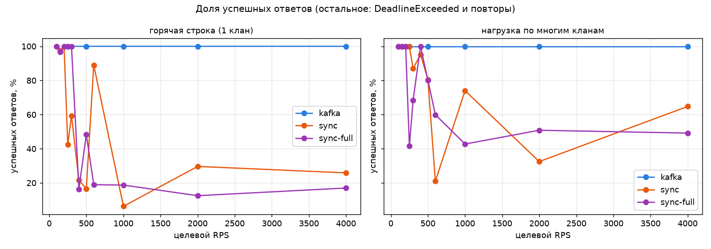
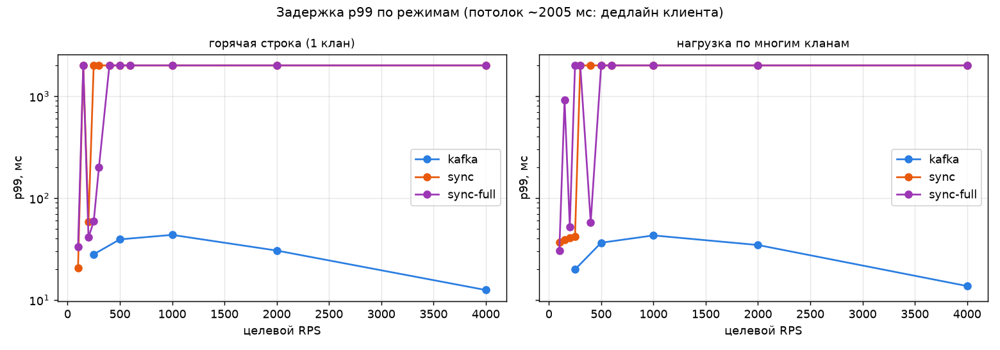
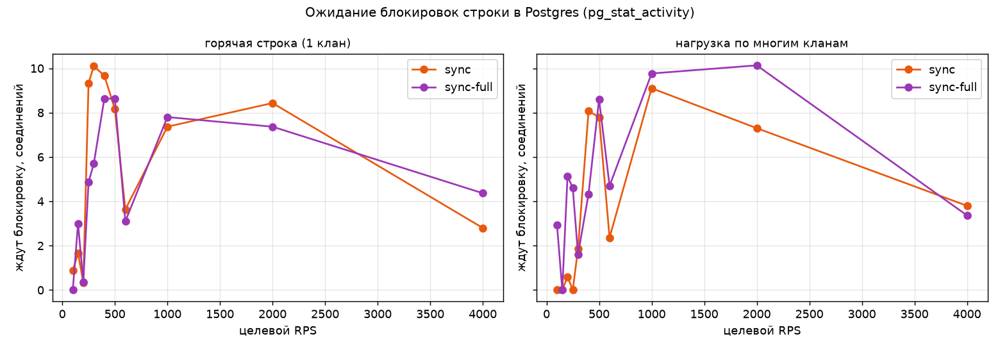

# Эксперимент «горячая строка»: подробности

Краткие выводы и главные графики — в [README проекта](../../README.md), раздел 12. Здесь методика, остальные графики и ограничения. Полная таблица всех 74 прогонов — [results.md](results.md) (генерируется `loadtest/hotrow_report.py`).

## Методика

- **Режимы `api`** (`ATTACK_MODE`): `kafka` (очередь, пачки в консьюмере), `sync` (`UPDATE raids` + `INSERT raid_hits` в запросе), `sync-full` (вся логика консьюмера на каждый удар в запросе: `raid_damage`, outbox, Redis).
- **Стенд:** одна машина, Docker Desktop, всё вместе с `botsim` (как в разделе 11). `fsync` диска Postgres в контейнере: ~930 операций/с, около 1.1 мс на синхронизацию (`pg_test_fsync`).
- **Нагрузка:** `botsim --mode open`, разгон 5 с, 30 с установившейся нагрузки, дедлайн клиента 2 с (отсюда потолок p99 ≈ 2005 мс на графиках).
- **Две формы:** `hot` — 1 клан × 2500 игроков (все удары в одну строку), `spread` — 40 кланов × 60 игроков (те же RPS по 40 строкам). Игроков много из-за rate limit 5 ударов/с на игрока: клан из 50 игроков упёрся бы в него на ~250 RPS.
- **Пул `api`:** 16 соединений, кроме перебора `PG_MAX_CONNS` (4, 8, 16, 32, 64) при целевых 1000 RPS.
- **Чистота прогонов:** перед каждым прогоном база и Redis очищаются, `api` перезапускается; после прогона `raidctl verify` (для `sync` без инварианта 4: этот режим не ведёт `raid_damage`).
- **Сэмплер:** раз в секунду `pg_stat_activity` и `pg_locks`, одной сессией `psql` с `\watch`.
- **Воспроизведение:** `loadtest/hotrow.sh`, затем `python loadtest/hotrow_report.py` (нужен matplotlib). Полный прогон около 1.5 часа.

## Доля успешных ответов

## p99

Потолок ~2005 мс — дедлайн клиента: в зоне обвала p99 не различает «плохо» и «очень плохо», для этого служит доля успешных ответов.

## Ожидание блокировок

Среднее число соединений в `pg_stat_activity` с `wait_event_type = Lock` на установившейся нагрузке. Начиная с границы деградации в среднем 8–10 из 16 соединений пула стоят в ожидании, максимум 15 из 16.

## Полная таблица ступеней

Успешных ответов в секунду (p99 в скобках, `×` — больше 2 с). Целевой RPS не включает ~5% повторов с тем же `idempotency_key`, поэтому успешных чуть меньше цели.

| Целевой RPS | kafka, hot | kafka, spread | sync, hot | sync, spread | sync-full, hot | sync-full, spread |
|---|---|---|---|---|---|---|
| 100 | – | – | 95 (21 мс) | 94 (37 мс) | 96 (33 мс) | 95 (31 мс) |
| 200 | – | – | 190 (59 мс) | 189 (41 мс) | 191 (41 мс) | 189 (52 мс) |
| 250 | 240 (28 мс) | 239 (20 мс) | 101 (×) | 238 (42 мс) | 238 (59 мс) | 98 (×) |
| 500 | 477 (39 мс) | 475 (36 мс) | 77 (×) | 365 (×) | 224 (×) | 358 (×) |
| 1000 | 956 (44 мс) | 953 (43 мс) | 53 (×) | 665 (×) | 160 (×) | 367 (×) |
| 4000 | 3820 (13 мс) | 3754 (14 мс) | 246 (×) | 719 (×) | 156 (×) | 503 (×) |

## Перебор размера пула (1000 RPS)

Успешных ответов в секунду. Для `sync` на `spread` доля ошибок при пуле 64 — 0%, при 32 — 1%; остальные ячейки с большой долей таймаутов, подробности в [results.md](results.md).

| Пул | sync, hot | sync, spread | sync-full, hot | sync-full, spread |
|---|---|---|---|---|
| 4 | 424 | 363 | 260 | 79 |
| 8 | 85 | 295 | 146 | 297 |
| 16 | 294 | 160 | 180 | 110 |
| 32 | 140 | 870 | 56 | 573 |
| 64 | 52 | **950** (p99 95 мс) | 116 | 876 |

## Ограничения

- Каждая точка — один прогон 30 с, повторов нет. Вблизи границы (150–600 RPS) результат сильно зависит от случайных столкновений на строках: читать как «неустойчиво», а не как точную границу.
- Всё на одной машине с Docker Desktop, абсолютные значения привязаны к `fsync` ≈ 1.1 мс. С быстрым `fsync` или `synchronous_commit = off` граница сдвинется выше; это не проверялось.
- Метрики пула из VictoriaMetrics при перегрузке теряли точки, поэтому в отчёт не вошли (сырые данные — в `loadtest/results/hotrow/*/pool.tsv`, каталог в `.gitignore`). Насыщение пула оценивается по `pg_stat_activity`.
- Лаг консьюмера в режиме `kafka` снимался один раз в конце нагрузки: `kafka-consumer-groups` запускает JVM и сам искажал бы задержки. К концу прогонов лаг был нулевым.
- Оценка «блокировка держится ~1 мс коммита плюс `UPDATE`/`INSERT`» — рассуждение по порядку величины, прямо время удержания блокировки не измерялось.
